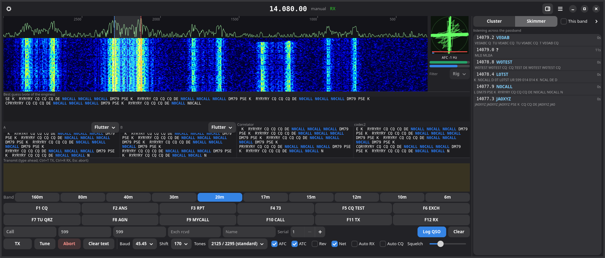

# gtty user manual

gtty is an amateur radio RTTY terminal for the Linux and macOS desktop. It decodes Baudot RTTY from a sound card with several demodulators running in parallel, shows the band on a waterfall and an XY tuning scope, transmits by AFSK audio or true FSK keying, controls the transceiver through Hamlib, keeps a logbook, and talks to GridTracker and to loggers that know how to drive fldigi.

## Where to start

| If you want to… | Read |
|---|---|
| Install a package or build from source | [Installation](installation.md) |
| Get decoding and make a first QSO | [Quick start](quick-start.md) |
| Know what every control does | [The main window](main-window.md) |
| Tune signals and understand AFC, ATC, Rev and Net | [Tuning](tuning.md) |
| Understand the decoder engines and the Skimmer | [Decoders](decoders.md) |
| Set up AFSK, FSK or CAT keying | [Transmitting](transmitting.md) |
| Connect a rig | [Rig control](rig-control.md) |
| Log QSOs, use Super Check Partial and callbooks | [Logging](logging.md) |
| Edit the F-key messages | [Macros](macros.md) |
| Keep separate setups for contests, rigs or portable | [Configurations](configurations.md) |
| Use DX cluster spots | [DX cluster band map](cluster.md) |
| Connect GridTracker, CQRLOG, TLF and friends | [Integrations](integrations.md) |
| Decode recordings or test from a terminal | [gtty-cli](gtty-cli.md) |
| Fix a problem | [Troubleshooting](troubleshooting.md) |
| Look up a shortcut, a file path or a default | [Reference](reference.md) |

## Why gtty exists

The Windows programs RTTY contesters reach for, MMTTY, 2Tone and Gritty, have no Linux equivalent, and fldigi's RTTY is one mode among dozens behind a GTK 2 interface. gtty does one mode on a current GTK4 and libadwaita desktop, with the ideas that make the Windows tools good: several decoders voting on each character, a Gritty-style character correlator, a skimmer that decodes the whole passband, true FSK keying through an ordinary USB serial adapter, and a contest layout with band buttons, macros and the log row always in view.

## Conventions used in this manual

- *Preferences → Rig* means the Rig page of the Preferences dialog, opened from the gear button in the header bar or with **Ctrl+,**.
- Menu items live under the ☰ button at the right of the header bar.
- Default values are quoted where they matter. The full list is in the [Reference](reference.md).
